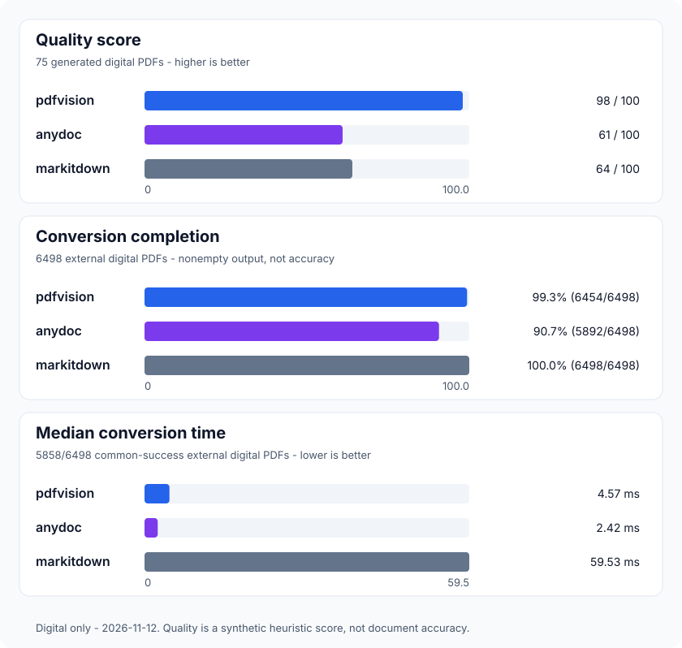

# pdfvision

[](https://github.com/yashasg/pdfvision/actions/workflows/code-quality.yml)
[](https://github.com/yashasg/pdfvision/actions/workflows/nightly-eval.yml)
[](Package.swift)
[](Package.swift)
[](LICENSE)
[](https://skills.sh/yashasg/pdfvision)

Swift library and CLI that converts digital and scanned PDFs to GitHub-Flavored Markdown on macOS. PDFKit handles digital text; Apple Vision runs OCR on-device. No external OCR service is needed.

Convert once, then let agents request only the sections they need through swift-markdown. One local book-query eval used **80.2% fewer tokens** than full Markdown, including outline and retrieval overhead. [Measurement details](#context-savings).

## Quick start

### Agent skill

Install the [Agent Skill](https://agentskills.io) so your agent can convert PDFs and retrieve selected sections:

```bash
npx skills add yashasg/pdfvision
```

### CLI

Build and install on macOS:

```bash
git clone https://github.com/yashasg/pdfvision.git
cd pdfvision
swift build -c release
cp .build/release/pdfvision /usr/local/bin/pdfvision
```

Usage:

```bash
pdfvision document.pdf                  # Markdown to stdout (auto Vision OCR on scanned pages)
pdfvision document.pdf -o out.md         # Write to a file
pdfvision document.pdf --ocr disabled    # Exit 3 if scanned pages need OCR
pdfvision document.pdf --json            # JSON with { markdown, pageCount, ocrPages, links, pages }
pdfvision - < document.pdf               # Read PDF bytes from stdin
pdfvision --batch documents/*.pdf -o markdown/
```

Batch mode creates the output directory and writes one `.md` file per input, or `.json` with `--json`, in a single process. It refuses to overwrite existing files, rejects duplicate output names, and reports individual failures while continuing with the remaining inputs. A failed batch exits nonzero. Expand directories with a shell glob; batch stdin is not supported.

### Swift package

Add `pdfvision` to your `Package.swift`. The library product and import remain `PDFMarkdown`:

```swift
dependencies: [
    .package(url: "https://github.com/yashasg/pdfvision.git", from: "0.1.0"),
]
```

```swift
import PDFMarkdown

// 1. One-liner to Markdown string (auto Vision OCR on scanned pages):
let markdown = try PDFMarkdown.toMarkdown(at: URL(fileURLWithPath: "resume.pdf"))

// 2. From in-memory Data:
let fromBytes = try PDFMarkdown.toMarkdown(data: pdfData, ocr: .automatic)

// 3. Full structured result (with extracted PDFAnnotation links & OCR page numbers):
let doc = try PDFMarkdown.extract(at: URL(fileURLWithPath: "resume.pdf"))
print(doc.pageCount) // 1
print(doc.ocrPages)  // [] for digital PDFs, [1] for scanned PDFs
print(doc.links)     // [Link(page: 1, label: "GitHub", url: "https://github.com/example")]

// Inspect an outline, then retrieve a selected section:
let context = MarkdownContext(markdown: doc.markdown)
let outline = context.outline
let section = try context.section(id: "s2") // Use an ID from outline.
```

## Read selected sections

Convert a PDF once, inspect its outline, then retrieve the section you need:

```bash
pdfvision report.pdf -o report.md
pdfvision report.md --from-markdown --outline
pdfvision report.md --from-markdown --section s2
```

`--outline` returns section IDs, titles, and heading levels as compact JSON. Use an ID with `--section` to read that section and its subsections, stopping at the next peer or ancestor heading. Add `--json` for `{ id, title, level, markdown }`.

Queries use [swift-markdown](https://github.com/swiftlang/swift-markdown)'s parsed tree locally. Reusing saved Markdown avoids repeating PDF extraction or OCR. You can also query a PDF directly with `pdfvision report.pdf --outline` or `--section s2`; ordinary conversion and batch mode do not parse a Markdown tree.

IDs apply to the same unchanged input. When listed, `s0` selects the preamble or a document without headings. Selection follows the extracted headings and may normalize Markdown formatting. PDF editing and write-back are [future work](https://github.com/yashasg/pdfvision/issues/1).

## Benchmarks

### Context savings

One local book-query eval used **12,356 tokens instead of 62,403 (80.2% fewer)** for full Markdown. That includes the outline and retrieval overhead, with the required answer evidence retained. Counts use `o200k_base`; savings vary by document and query and do not measure native PDF or image billing.

<details>
<summary>Measure context savings locally</summary>

Use an eval-only tokenizer environment and an existing Markdown file:

```bash
python3 -m venv .build/context-eval-env
.build/context-eval-env/bin/python -m pip install -r scripts/requirements-context.txt
.build/context-eval-env/bin/python scripts/eval-context.py report.md \
  --section s2 --encoding o200k_base \
  --question "What are the payment terms?" --expect "30 days"
```

The JSON report compares full Markdown with the outline, selected sections, and retrieval-command overhead using the specified tokenizer. Repeat `--section` or `--expect` as needed. Missing answer evidence makes the eval fail, and negative savings are reported unchanged.

Counts apply to the serialized text payloads, not native PDF/image input, provider billing, or automatic section selection. Evidence matching is a substring check, not an LLM answer-quality assessment. Documents stay local; the tokenizer may download its vocabulary on first use. Neither competitor packages nor PDF corpora are needed.

</details>

### Digital PDF conversion

The benchmark compares pdfvision with [`@firecrawl/anydoc` `0.2.4`](https://github.com/firecrawl/anydoc) and MarkItDown on digital PDFs only. OCR remains covered by pdfvision's own tests.

<!-- BENCHMARK:START -->


Synthetic digital quality (75 PDFs): 3 categories: `digital-2col`, `digital-links`, `digital-single`. Failed or empty conversions receive zero quality points. 75/75 documents successfully converted by every tool.

External digital completion and timing (6498 PDFs): no matching Markdown ground truth, so no quality score. Speed uses the same 5858/6498 documents successfully converted by every tool; failures remain in the completion counts.

[Scores and chart data](bench/latest.json). [Full reports and per-category results](https://github.com/yashasg/pdfvision/actions/runs/43136564753). Measured 2026-11-12. Higher quality/completion is better; lower time is better.
<!-- BENCHMARK:END -->

<details>
<summary>Corpus and scoring</summary>

GitHub setup installs the pinned competitors in runner-local directories and downloads the pinned [Sinabis 10k corpus](https://huggingface.co/datasets/sinabis-group/sinabis-10k-synthetic-pdf) (CC BY 4.0, Sinabis GmbH). It verifies the archive SHA-256 and selects **6,498 digital PDFs**, excluding simulated scans. These bulk downloads and competitor installs run only in GitHub Actions.

The **75 generated digital PDFs** have ground truth for quality scoring. The business-document corpus measures conversion completion and timing by document type, without Markdown quality scores. PDFs needing OCR fail explicitly because pdfvision runs with OCR disabled. The workflow uploads reports and the generated README for review; it does not push to protected `main`. Digital-only results do not reuse the previous mixed digital/OCR measurements.

</details>

## Development

<details>
<summary>PDF corpus and development checks</summary>

### PDF test corpus

The harness includes a pinned manifest of **51 external PDFs** (~5.4 MB including license notices), separate from the synthetic benchmark above. Use Node.js 22+; extraction additionally requires macOS.

```bash
node scripts/pdf-corpus.mjs fetch   # GitHub setup only: download and verify PDFs and attribution
node scripts/pdf-corpus.mjs check   # Verify the local cache without network access
node scripts/pdf-corpus.mjs run     # macOS: build the CLI and run extraction/rejection smoke checks
node --test scripts/pdf-corpus.test.mjs
```

Files are cached in ignored `bench/corpus/files/`; results go to `bench/corpus/run.json`. Downloads use immutable upstream commits recorded in [`bench/corpus.json`](bench/corpus.json). Corrupt cache entries fail verification rather than being silently reused.

| Coverage | Examples |
| --- | --- |
| Digital documents | LaTeX, LibreOffice, Google Docs, HTML print, multi-column layouts, 117-page mathematics book |
| OCR | Historical scans, French accents, skew/rotation, CCITT/JBIG2, searchable scans, outlined vector text |
| Document features | Arabic/RTL and Unicode maps, tables, forms, annotations, links, attachments, layers, cropped/scaled pages |
| PDF internals | Tagged PDF 2.0, PDF/A and PDF/UA test files, linearization, object streams, hybrid/damaged xrefs |
| Rejection paths | Password protection, RC4 encryption, malformed/truncated files, zero-page and textless documents |

Sources: [py-pdf/sample-files](https://github.com/py-pdf/sample-files) (CC BY-SA 4.0), [OCRmyPDF](https://github.com/ocrmypdf/OCRmyPDF) (per-file licenses), [qpdf](https://github.com/qpdf/qpdf) (Apache 2.0), and [veraPDF](https://github.com/veraPDF/veraPDF-corpus) (CC BY 4.0). Their original attribution and license files are downloaded into `bench/corpus/notices/`. PDFs are unmodified; their licenses are **not** replaced by this project's MIT license.

These are smoke cases, **not Markdown quality ground truth**: successful extraction does not establish reading order, table fidelity, or multilingual accuracy. Rejections are checked against specific CLI errors; timeouts and crashes fail. The tiny two-glyph `type3-no-unicode` sample currently exposes an extraction gap, so `run` reports it and exits nonzero rather than hiding it. This is broad coverage, not every PDF type; CJK, handwriting, signatures, and very large files remain gaps.

### Tooling

Tool versions are pinned in [`Mintfile`](Mintfile) and the separate [Danger package](Tools/Danger/Package.swift), which builds the runtime library Danger needs. On macOS, with Node.js/npm installed:

```bash
brew install mint
make bootstrap     # Install SwiftLint, SwiftFormat, Danger Swift, and Periphery
make quality       # Check formatting and lint
make format        # Apply SwiftFormat
make unused        # Periphery; retains public library API
make danger        # Local Danger checks against main
```

The code-quality GitHub workflow runs formatting, lint, Swift tests, Periphery, corpus script tests, and PR Danger checks on macOS using the runner's Xcode toolchain. Development tools add no runtime dependencies.

</details>

## License

[MIT](LICENSE)
